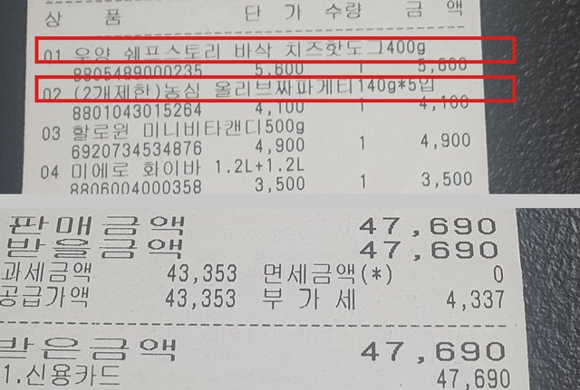
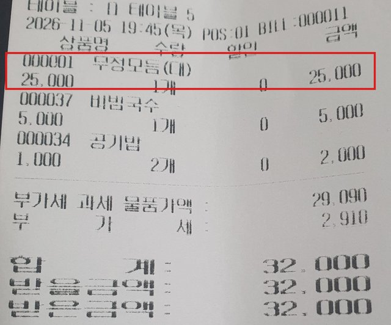
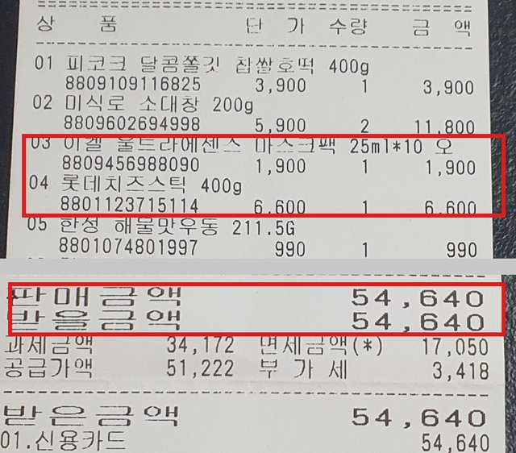

# 영수증 OCR 개선 요약 (0 ~ 6회차)

- 읽는 사람: OCR 작업의 진행 상황을 처음 보는 팀원
- 자세한 기록: `docs/ocr-report.md` (회차별 실험 전체)
- 기준일: 2026-11-25 · 코드: `server/app/ocr/` · 브랜치 `feature/receipt-ocr` (아직 push 전)

## 1. 한눈에 보기

- **무엇을 만드나**: 영수증 사진을 올리면 가게 이름 · 합계 · 품목을 채운 **초안**을 만들어 줍니다. 사용자는 '확인 중' 화면에서 초안을 고친 뒤 저장합니다.
- **어떻게 했나**: 6회에 걸쳐 "오류 분석 → 개선 → 미리 정한 기준으로 측정"을 반복했습니다.
- **결과**: 엔진을 바꾸기 전(2회차)과 같은 test 사진 7장으로 비교하면, 합계를 맞힌 영수증이 2장 → 6장, 품목 점수(F1)가 0.42 → 0.75가 됐습니다.
  품목 점수는 OCR 엔진 교체(3회차)에서 가장 크게 올랐고, 합계는 그 뒤의 파서 · 다시 읽기 개선(4 ~ 6회차)에서 주로 올랐습니다.
- **지금 수준**: 사용자가 확인하고 고치는 '초안 보조' 기능으로는 쓸 만한 수준에 가깝습니다. 확인 없이 자동으로 입력하기에는 부족합니다.
  test 진짜 영수증 11장 중 합계는 7장이 맞았고, 가게 · 합계 · 품목이 모두 맞은 영수증은 3장이었습니다(이 3장에도 이름 오타 몇 글자는 남음). 실제 사진 예시는 8절에 있습니다.
- **남은 큰 일**: 아직 앱(서버)에 연결하지 않았습니다. 엔진 설치 방식과 비동기 처리는 팀이 함께 정해야 합니다(9절).

## 2. 무엇을 만드나

```
사진 → ① 전처리 → ② OCR 엔진 → ③ 줄 묶기 → ④ 파서 → 초안 + 경고
```

| 단계 | 하는 일 |
| --- | --- |
| ① 전처리 | 사진 회전을 바로잡고 크기 · 명암을 맞춤 |
| ② OCR 엔진 | 사진에서 글자와 그 위치를 읽음 (지금 선택: PaddleOCR) |
| ③ 줄 묶기 | 글자 상자를 영수증의 한 줄 단위로 묶음 |
| ④ 파서 | 줄마다 품목 · 합계 · 할인 · 무시할 줄을 판단하고, 산수(단가 × 수량 = 금액, 품목 합 = 합계)로 검산 |

초안이 산수와 맞지 않으면(예: 품목 합 ≠ 합계) 경고를 띄워 사용자가 어디를 고칠지 알려 줍니다.
다만 이름을 잘못 읽은 것처럼 산수와 상관없는 오류에는 경고가 뜨지 않습니다(8절).

## 3. 어떻게 실험했나

**평가 데이터**

| 구분 | dev: 규칙을 고칠 때 보는 사진 | test: 점수만 재는 사진 |
| --- | --- | --- |
| 진짜 영수증 사진 | 15장 | 11장 |
| 가짜 영수증 (프로그램으로 그린 깨끗한 영수증) | 6장 | 6장 |

- 진짜 사진 26장은 팀원이 이번 달에 찍은 사진 18장과 예전 영수증 사진 8장(대부분 인터넷에 공개된 사진)이고, 식당 · 카페 13장, 마트 · 매장 · 주유소 13장입니다.
  공개 저장소에 올라가므로 개인정보(카드번호 · 승인번호 · 대표자 · 전화 등)를 가리고 위치 정보(EXIF)를 지운 뒤 넣었습니다.
- **dev와 test를 나누는 이유**: 고칠 때 본 사진으로 점수를 재면 시험 문제를 미리 본 것처럼 점수가 부풀려집니다.
  그래서 규칙은 dev만 보고 고치고, test는 회차가 끝날 때 한 번만 잽니다.

**점수**

| 점수 | 뜻 |
| --- | --- |
| 합계 | 합계 금액을 정확히 맞힌 영수증 수 |
| 품목 F1 | 품목을 맞힌 정도. 놓친 품목과 엉뚱하게 만든 품목을 함께 반영하며 1.0이 만점. 금액 · 종류가 같고 이름이 70% 이상 비슷하면 맞힌 것으로 봄 |
| 모두 맞은 영수증 | 가게 이름 · 합계 · 품목이 모두 맞은 영수증. 이름은 위 기준(70% 이상 비슷)으로 보므로 오타 몇 글자는 남을 수 있음 |

**2회차부터는 회차마다 같은 순서로 진행했습니다**

```
오류 분석(dev) → 원인 찾기 → 개선안 → 채택 기준을 먼저 기록 → dev로 측정 → 채택하면 test로 한 번 확인 → 보고서 · 커밋
```

- **채택 기준을 결과보다 먼저 적었습니다.** 결과를 본 뒤에 기준을 정하면 원하는 결론에 맞추게 되기 때문입니다.
  그래서 효과가 없거나 다른 사진을 해친 시도는 기각하고 그 이유까지 기록했습니다(전처리 24가지 조합, 파서 규칙 3건 등).
- 파서만 바꾸는 실험은 OCR 결과를 저장해 두고 파서만 다시 돌려 빠르게 비교했습니다. 마지막에는 실제 평가 명령(`python -m app.ocr.bench`)의 결과와 같은지 확인했습니다.

## 4. 회차별로 한 일

| 회차 | 발견한 문제 | 한 일 | 결과 · 결정 |
| --- | --- | --- | --- |
| 0 | - | 낱말 규칙으로 줄을 나누는 파서 (출발점, Tesseract 엔진) | 진짜 사진에서 품목을 대부분 놓침 |
| 1 | 숫자가 띄어 읽힘(`69, 000`), 금액 오인식 | 글자 위치로 표의 열(단가 · 수량 · 금액)을 나눔, 산수 검산 | test 사진 품목 0/7 → 5/7 (진짜 사진이 3장뿐이던 때) |
| 2 | 휜 사진 · 그림자 | 전처리 5단계(자르기 · 크기 · 조명 · 기울기 · 흑백)를 켜고 끄며 24가지 조합 비교 | 기준을 넘은 조합이 없어 기본값 유지. 표 읽기 버그 1건 발견 · 수정 |
| 3 | 엔진이 한글 이름 · 숫자를 잘못 읽음 | 엔진 4종 비교 (Tesseract 두 모델, EasyOCR, PaddleOCR) | **PaddleOCR 확정.** dev F1 0.44 → 0.72, test 0.42 → 0.68. 대신 장당 약 10초, 별도 설치 환경 필요 |
| 4 | 엔진은 다 읽는데 파서가 품목 · 합계를 놓침 | 두 줄로 찍힌 마트 품목 읽기, 세금 줄(공급가 + 부가세 10%) 산수로 합계 찾기, 마트형 사진 5장 추가 | dev 합계 9 → 13/14, test(11장) 합계 3 → 5 |
| 5 | 줄 간격이 좁은 영수증에서 엔진이 품목 이름을 세로로 이어 읽음 | 그 증상이 보이는 사진만 세로로 늘려 다시 읽기 | dev F1 0.87 → 0.91, 나빠진 사진 0장 |
| 6 | 합계 낱말을 잘못 읽으면 합계를 못 찾고 결제 줄까지 품목이 됨 | 결제 줄에 되풀이된 금액이 품목 합과 맞으면 합계로 사용 | dev 합계 14/14, test 합계 1장 추가, 새로 틀린 합계 0건 |

## 5. 점수 변화 (2회차부터 같은 사진으로)

진짜 영수증 사진 기준입니다(dev 14장 · test 7장). 2회차까지는 Tesseract, 3회차부터는 PaddleOCR입니다.

| 회차 | 바꾼 것 | dev 합계 | dev 품목 F1 | test 합계 | test 품목 F1 |
| --- | --- | --- | --- | --- | --- |
| 2 | 엔진 바꾸기 전 (Tesseract) | 4/14 | 0.44 | 2/7 | 0.42 |
| 3 | 엔진 → PaddleOCR | 9/14 | 0.72 | 3/7 | 0.68 |
| 4 | 파서: 마트 품목 · 세금 줄 | 13/14 | 0.87 | 4/7 | 0.71 |
| 5 | 빽빽한 영수증 다시 읽기 | 13/14 | 0.91 | 5/7 | 0.75 |
| 6 | 반복 금액으로 합계 찾기 | **14/14** | **0.91** | **6/7** | **0.75** |

- 0 · 1회차는 진짜 사진이 2 ~ 3장뿐이던 때라 이 표와 직접 비교할 수 없습니다.
- 4회차가 끝난 뒤 test 사진의 오류를 자세히 들여다봤기 때문에, 5 · 6회차의 test 점수는 실제보다 좋게 나왔을 수 있습니다.
- 4회차에 사진을 더한 전체 데이터(진짜 dev 15장 · test 11장)로 보면, 지금은 dev 합계 15/15 · F1 0.91, test 합계 7/11 · F1 0.75입니다.
- 진짜 test 사진이 7 ~ 11장뿐이라 0.02 정도의 차이는 우연일 수 있습니다.

## 6. 배운 점

1. **사진 다듬기보다 엔진 선택의 효과가 훨씬 컸습니다.** 전처리 24가지 조합은 점수를 올리지 못했고, 엔진 교체 한 번으로 품목 F1이 0.44 → 0.72가 됐습니다.
2. **엔진이 글자를 다 읽은 뒤에는 파서가 병목입니다.** PaddleOCR은 test 사진의 정답 금액을 100% 읽었지만, 품목 F1은 0.75에 머뭅니다.
3. **특정 가게 형식에 맞춘 규칙보다 산수처럼 일반적인 신호가 처음 보는 영수증에서 통했습니다.**
   코스트코 형식에 맞춘 규칙은 다른 마트에서 효과가 확인되지 않았지만, 세금 줄 산수(4회차)와 반복 금액 산수(6회차)는 처음 보는 영수증에서도 작동했고 틀린 합계를 만들지 않았습니다.
4. **한 가지 설정이 모든 사진에 좋지는 않았습니다.** 빽빽한 영수증을 살리는 설정이 보통 영수증을 해쳐서, 증상이 보이는 사진에만 쓰도록 했습니다(5회차).
5. **사진이 적을 때 본 효과는 사진을 늘리면 사라지기도 했습니다.** 사진 3장으로는 좋아 보였던 전처리가 14장에서는 효과가 없었습니다(2회차). 그래서 기준을 먼저 정하고 test는 한 번만 잽니다.

## 7. 지금 수준과 한계

**test 진짜 영수증 11장 (규칙을 만들 때 쓰지 않은 사진, PaddleOCR, 6회차)**

| 항목 | 결과 |
| --- | --- |
| 합계를 맞힌 영수증 | 7/11 (64%) |
| 품목 F1 | 0.75 (마트형 0.83 · 식당 · 카페형 0.59) |
| 모두 맞은 영수증 | 3/11 (27%) |
| 가게 이름 | 5/11 (45%) |
| 엔진이 읽어 낸 정답 금액 | 100% |
| 장당 처리 시간 (개발 PC의 CPU) | 평균 15.5초, 가장 느린 장 26.5초 |

- 5절에서 말한 대로 이 test는 4회차 이후 들여다본 사진이라 실제 실력은 이보다 낮을 수 있습니다.
- **식당 · 카페 영수증은 품목이 약하고(F1 0.59), 마트 영수증은 합계를 틀린 경우가 많습니다(test 5장 중 3장).**
  모임 정산 앱에서는 식당 · 카페 영수증이 많을 수 있어 품목 읽기가 다음 개선 대상입니다.
- **아직 앱에 연결하지 않았습니다.**
  - 서버 기본값은 고정 답을 주는 `stub` 엔진입니다.
  - PaddleOCR은 기존 패키지와 충돌해 별도 환경(약 1GB)에만 설치돼 있습니다.
  - 서버가 지원하는 다른 엔진인 Tesseract는 따로 설치해야 하고(지금 Docker 서버에는 없음), 같은 test에서 품목 F1이 0.27입니다.
- **속도**: 지금 API는 요청 안에서 OCR이 끝나기를 기다립니다. 장당 10초가 넘어서 비동기 처리(Worker)가 필요합니다.
- **데이터**: 진짜 test 사진이 11장뿐이고 새 사진을 구하기 어려워, 앞으로의 개선은 효과를 확인할 근거가 약해집니다.
- **남은 오류**: 두 품목이 한 줄로 합쳐지는 경우, 할인 칸이 낀 두 줄 품목, 이름에 '쿠폰'이 들어간 품목을 할인으로 읽는 것, 가게 이름.

## 8. 실제 사진으로 본 결과

7절의 숫자가 실제로 어떤 모습인지 test 진짜 영수증의 6회차 결과로 보여 줍니다.
좋은 예시만 고른 것처럼 보이지 않도록 11장 전체 결과를 먼저 싣습니다.

| 결과 | 장수 | 사진 (test_real_) | 경고 |
| --- | --- | --- | --- |
| 가게 · 합계 · 품목 모두 맞음 | 3 | 01(마트) · 06(카페) · 07(식당) | 없음 |
| 합계는 맞고 고칠 곳이 있음 | 4 | 03 · 04 · 05(식당), 08(마트) | 03 · 08은 있음, 04 · 05는 없음 |
| 합계 틀림 | 4 | 02(바비큐 매점), 09 · 10 · 11(마트) | 4장 모두 있음 |

- **합계가 틀린 4장은 모두 경고가 떴습니다.** 경고는 산수가 맞지 않거나(품목 합 ≠ 합계, 단가 × 수량 ≠ 금액) 가게 이름 · 품목 · 합계를 찾지 못했을 때 뜹니다.
- **잘못 읽은 이름은 경고로 잡지 못합니다.** 04는 가게 이름 뒤에 사업자번호가 붙었고, 05는 품목 이름이 숫자로 들어갔는데도 경고가 없었습니다.
  그래서 경고가 없어도 사용자가 초안을 확인하는 화면이 필요합니다.
- 06 · 07에는 '줄 간격을 벌려 다시 읽었다'는 안내만 떴습니다(5회차 기능).
- 사진은 저장소에 올린 사진(개인정보를 가린 것)에서 필요한 부분만 잘라 붙였고, 빨간 테두리는 설명을 위해 그렸습니다.
- 이 실패 사례를 보고 규칙을 고치면 test 점수가 부풀려집니다. 고칠 때는 비슷한 dev 사진으로 합니다.

### 예시 1. 잘된 경우: 마트 영수증, 품목 17개 (test_real_01)



| 칸 | 정답 | 초안 | 판정 |
| --- | --- | --- | --- |
| 가게 | 207피트 파주본점(물류아울렛) | 207피 트 파주본점(물류아울렛) | 맞음 |
| 합계 | 47,690 | 47,690 | 맞음 |
| 품목 | 17개 | 17개, 금액은 모두 정확 | 맞음 |
| 이름 예 (01번) | 우양 쉐프스토리 바삭 치즈핫도그400g | 우 리 바삭 치즈핫도그4009 | 맞음으로 셈 |
| 이름 예 (02번) | (2개제한)농심 올리브짜파게티140g*5입 | (2개제한)동 올리브짜파게티 | 맞음으로 셈 |
| 경고 | - | 없음 | - |

- 금액과 합계는 모두 맞았지만 이름에는 오타가 몇 글자 남았습니다(빨간 테두리). 채점은 이름이 70% 이상 비슷하면 맞은 것으로 봅니다.
- 큰 글씨로 찍힌 합계 줄(판매금액 · 받을금액)은 낱말을 읽지 못했습니다.
  대신 결제 줄에 되풀이된 47,690이 품목 합과 맞아서 합계로 찾았습니다(6회차 개선, 5회차까지는 이 영수증의 합계를 틀림).

### 예시 2. 합계는 맞았지만 고칠 곳이 있는 경우: 식당 영수증 (test_real_05)



| 칸 | 정답 | 초안 | 판정 |
| --- | --- | --- | --- |
| 가게 | 무정집 | 단저지 무상산 | 틀림 |
| 합계 | 32,000 | 32,000 | 맞음 |
| 품목 1 | 무정모듬(대) · 25,000 | '25,000 1개' · 25,000 | 금액만 맞음 |
| 품목 2 | 비빔국수 · 5,000 | '5,000 1개' · 5,000 | 금액만 맞음 |
| 품목 3 | 공기밥 · 2,000 | '1,000 2개' · 2,000 | 금액만 맞음 |
| 경고 | - | 없음 | - |

- 이 영수증은 품목 이름 줄(`000001 무정모듬(대)`) 아래에 단가 · 수량 · 할인 · 금액 줄이 따로 찍힙니다(빨간 테두리).
  엔진은 이름도 읽었지만, 파서가 두 줄을 한 품목으로 묶지 못해 아래 줄의 숫자를 이름으로 썼습니다. 7절 '남은 오류'의 '할인 칸이 낀 두 줄 품목'이 이것입니다.
- 금액이 맞아 산수 검사를 통과했고 가게 이름 칸도 엉뚱한 글자로 채워져서, 틀린 곳이 있는데도 경고가 뜨지 않았습니다.
- 큰 글씨의 합계 줄은 낱말을 읽지 못했지만, 세금 줄(물품가액 29,090 + 부가세 2,910 = 32,000)로 합계를 찾았습니다(4회차 개선).

### 예시 3. 합계를 못 찾은 경우: 마트 영수증, 품목 14개 (test_real_09)

예시 1과 같은 가게의 영수증입니다.



| 칸 | 정답 | 초안 | 판정 |
| --- | --- | --- | --- |
| 가게 | 207피트 파주본점(물류아울렛) | 207FEET | 틀림 (맨 위의 영문 로고를 읽음) |
| 합계 | 54,640 | (비어 있음) | 틀림 |
| 품목 | 14개 | 15개 중 12개 맞음 | 2개 놓침, 3개 잘못 만듦 |
| 경고 | - | 합계 금액을 찾지 못했습니다. | - |

- **줄 어긋남** (위쪽 빨간 테두리): 03번의 바코드 · 금액 줄(1,900)이 04번 이름 줄과 한 줄로 묶였습니다.
  그래서 '롯데치즈스틱'이 1,900원이 되고, 03번 품목과 04번의 금액 6,600원이 빠졌습니다.
- **큰 글씨** (아래쪽 빨간 테두리): 판매금액 · 받을금액 줄을 '판매 H', 'OH'처럼 읽었습니다.
  합계 낱말(받을금액)을 알아보지 못해 두 줄이 54,640원짜리 품목으로 들어갔습니다.
- 예시 1처럼 되풀이된 금액(54,640)으로 합계를 찾으려 했지만, 줄이 어긋나 품목 합(48,040)이 맞지 않았습니다.
  파서는 확인할 근거가 없으면 합계를 지어내지 않고 비워 둔 채 경고를 띄웁니다.
  사용자는 합계를 넣고, 잘못 들어간 두 줄을 지우고, 03 · 04번 품목을 고쳐야 합니다.

## 9. 다음 단계와 팀이 정할 것

1. **PaddleOCR 서버 적용 방식**: Docker 이미지나 컨테이너를 추가해야 하고 크기가 약 1GB입니다. 팀 합의가 필요합니다.
2. **비동기 처리**: 사진을 올리면 Worker가 OCR을 돌리고 초안을 채우는 V2 구조를 언제 적용할지 정합니다.
3. **목표와 합격 기준**: 이 기능을 '사용자가 확인하는 초안 보조'로 둘지 '자동 입력'으로 둘지 정하고, 숫자 기준(예: 처음 보는 사진에서 합계 80% 이상)을 정합니다.
4. **평가 데이터**: 사용자가 '확인 중'에서 고친 값이 곧 정답이므로, 앱을 쓰며 쌓이는 사진을 평가에 쓸 수 있습니다. 다만 사용자 동의와 개인정보 처리 방침이 먼저 필요합니다.
5. **(선택) 외부 OCR · LLM API 사용 여부**: 정확도를 더 올릴 수 있지만 사진이나 글자가 외부로 나가고 비용이 듭니다.

## 부록. 팀원이 알아둘 것

- **개발에는 영향이 없습니다.** 서버 기본값이 `OCR_ENGINE=stub`이라 OCR을 설치하지 않아도 화면 · API 개발에 영향이 없습니다.
- **코드와 설명**: `server/app/ocr/` 폴더와 그 안의 `README.md`(설치 · 실행 · 튜닝 위치)를 보면 됩니다.
- **평가 사진을 추가할 때**: `server/app/ocr/samples/`에 `이름.jpg`와 정답 `이름.json`을 넣습니다. 개인정보를 가리고 EXIF를 지운 사진만 넣고, 원본 폴더에서 다시 만들어 덮어쓰지 않습니다(가리기가 풀림).
